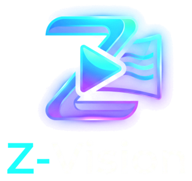

# Z-Vision



An IPTV player for **Android TV boxes, phones/tablets, Samsung TVs (Tizen) and LG TVs (webOS)**, inspired by the best parts of MyTVOnline, TiviMate, IPTV Smarters and others. Interface in **English, العربية (RTL) and Français**.

> Z-Vision is a player only — it ships with no channels. Add the playlist your provider gave you.

## Sources
| Type | What you enter |
|---|---|
| **Xtream Codes** | Server URL, username, password (pasting a full `get.php?username=…` link fills the fields automatically) |
| **M3U / M3U8** | A playlist link, or a file picked from the device |
| **MAC portal (Stalker)** | Portal URL + MAC address (`00:1A:79:…`) |
| **XMLTV EPG** | Optional custom guide URL (gzip supported); otherwise the provider's guide is used |

## Highlights
- **Live TV** — 3-pane layout on big screens (categories · channels · live preview + EPG), now-playing progress on every channel, Favorites / Recent / All.
- **Player** — ▲▼ / CH± zapping, number-key channel entry, OK/◀ opens the channel list overlay, ▶/MENU opens options: audio track, subtitles, aspect ratio, sleep timer, favorite, record, catch-up. Auto-reconnect on stream drops. Picture-in-picture on phones. Swipe up/down to zap on touch screens.
- **TV Guide** — TiviMate-style grid with 30-min ruler, ◀ Now ▶ navigation. Tap a programme to watch live, play catch-up, set a reminder or schedule a recording.
- **Catch-up / timeshift** — Xtream archive, M3U `catchup` (default / append / shift / flussonic) and portal archives.
- **Multi-view** — 2 or 4 channels at once; the focused tile has sound.
- **Recording** — record now or schedule from the guide (TS and HLS streams). Files are saved in the app's `Recordings` folder.
- **Movies & Series** — poster grids, sort (A–Z, newest, rating), details page with plot/cast/trailer, seasons & episodes, resume where you left off, auto-play next episode.
- **Profiles** — each profile keeps its own favorites, history and progress; **kids profiles** hide locked content.
- **Parental control** — PIN-lock any category (long-press / MENU on it), auto-lock adult categories, change PIN.
- **Global search** across channels, movies and series.
- Opens `.m3u` links shared from other apps.

## Install the APK
1. Download the latest `ZVision-*.apk` from the repository's **Releases** page (every push to `main` builds one automatically).
2. On the TV box / phone, allow installing from unknown sources for your browser or file manager, then open the APK.
   - On Android TV the app appears in the launcher row (it has a TV banner).

## Samsung & LG TVs (folder `tv/`)
The same features rebuilt as a TV web app: Live TV with preview + EPG, TiviMate-style guide with catch-up and reminders, movies & series with resume, multi-view, mini player, profiles, parental PIN, global search, colour & picture themes, app shortcuts (Netflix, Shahid…), Arabic/English/French. Not available on these TVs: recording to disk.

Every build publishes `ZVision-Samsung-*.wgt` and `ZVision-LG-*.ipk` next to the APK.

### تثبيت على تلفاز سامسونج
1. في التلفاز: **Apps** ← اضغط على الأرقام **1 2 3 4 5** في الريموت ← فعّل **Developer mode** واكتب عنوان IP لحاسوبك، ثم أعد تشغيل التلفاز.
2. على الحاسوب حمّل **Samsung Jellyfin Installer** (https://github.com/Jellyfin2Samsung/Samsung-Jellyfin-Installer) — يعمل على ويندوز وماك ولينكس، وهناك نسخة للهاتف.
3. اختر تلفازك، ثم اختر **Custom WGT** وحدد ملف `ZVision-Samsung-*.wgt`. سيطلب تسجيل الدخول بحساب سامسونج مرة واحدة لإنشاء الشهادة، ثم يثبّت التطبيق.

### تثبيت على تلفاز إل جي
1. أنشئ حسابًا مجانيًا على https://webostv.developer.lge.com وسجّل الدخول به في تطبيق **Developer Mode** من متجر LG على التلفاز، ثم فعّل **Dev Mode Status** و**Key Server**.
2. على الحاسوب ثبّت **webOS Dev Manager** (https://github.com/webosbrew/dev-manager-desktop) وأضف التلفاز بعنوان IP والعبارة السرية الظاهرة في تطبيق Developer Mode.
3. اضغط **Install** واختر ملف `ZVision-LG-*.ipk`.
4. وضع المطوّر في إل جي ينتهي بعد 50 ساعة؛ مدّده من تطبيق Developer Mode (أو من Dev Manager) حتى لا يُحذف التطبيق.

### Build the TV apps
```
cd tv && npm ci && node scripts/build.mjs   # → dist/ZVision.wgt and dist/webos/
npx ares-package dist/webos -o dist          # → .ipk
```

## Remote control cheat-sheet (full-screen live)
| Key | Action |
|---|---|
| ▲ / ▼, CH+ / CH− | Previous / next channel |
| 0–9 | Jump to channel number |
| OK or ◀ | Channel list |
| ▶, MENU or INFO | Options (audio, subtitles, aspect, record, catch-up, sleep timer) |
| BACK | Close overlay / exit player |
| MENU on a list item | Favorite a channel, lock/hide a category, add a movie to My list |

## Build it yourself
Requires JDK 17 and the Android SDK (or just Android Studio):
```
./gradlew assembleRelease
# → app/build/outputs/apk/release/app-release.apk
```
The GitHub Actions workflow in `.github/workflows/build.yml` does the same on every push and publishes the APK as a release.

Tech: Kotlin, Jetpack Compose, Media3 / ExoPlayer (HLS, DASH, MPEG-TS, RTSP, SmoothStreaming), OkHttp, kotlinx.serialization, Coil.
